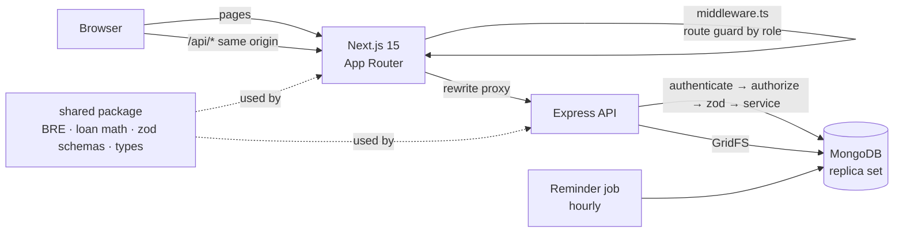
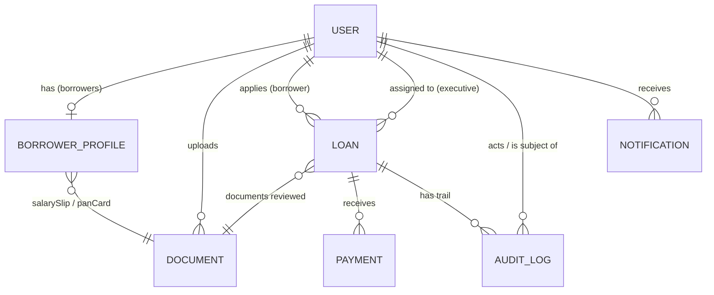
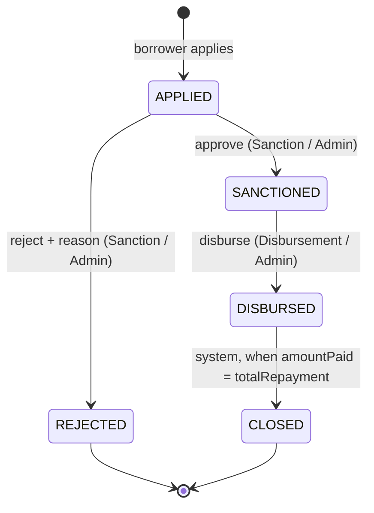

# CreditSea · Loan Management System

A full-stack lending platform: borrowers sign up, pass an eligibility check and apply for a loan in under a minute; internal teams move each loan through **Sanction → Disbursement → Collection** with role-based access, a full audit trail and automatic reminders.

> **Live demo:** **https://credit-sea-lms-omega.vercel.app** · log in with any account from [§2 Login credentials](#2-login-credentials)
> **Video walkthrough:** [Watch the demo on Google Drive](https://drive.google.com/file/d/1jaJNnNwlfAux3TQI_J8AGiWPhVjg2JvA/view?usp=sharing)
>
> The API runs on Render's free tier, which sleeps when idle: the **first request can take ~30–50 s** to wake it up.

| | |
|---|---|
| **Frontend** | Next.js 15 (App Router) · React 19 · TypeScript · Tailwind CSS v4 |
| **Backend** | Node.js · Express · TypeScript · zod |
| **Database** | MongoDB + Mongoose (replica set, so multi-document transactions work) |
| **Auth** | JWT in an httpOnly cookie · bcrypt |
| **Tests** | Vitest · Supertest · mongodb-memory-server (56 tests) |

---

## Contents
1. [Quick start](#1-quick-start)
2. [Login credentials](#2-login-credentials)
3. [What it does](#3-what-it-does)
4. [Architecture](#4-architecture)
5. [Data model](#5-data-model)
6. [Business rules](#6-business-rules)
7. [Role-based access control](#7-role-based-access-control)
8. [Design decisions (answers to the assignment's "Think about" questions)](#8-design-decisions)
9. [REST API](#9-rest-api)
10. [Testing](#10-testing)
11. [Security & compliance](#11-security--compliance)
12. [Project structure](#12-project-structure)
13. [Limitations & future work](#13-limitations--future-work)

---

## 1. Quick start

**Prerequisite:** Node.js 20+ (no MongoDB install needed: a local replica set is started for you).

```bash
git clone https://github.com/Amaan-Radhanpura/CreditSea-LMS.git
cd CreditSea-LMS
npm install                                   # installs all workspaces and builds the shared package

cp backend/.env.example backend/.env          # then set JWT_SECRET (see below)
cp frontend/.env.example frontend/.env.local  # same JWT_SECRET as the backend

npm run dev        # starts [db] MongoDB on :27017, [api] Express on :5000, [web] Next.js on :3000
npm run seed       # in a second terminal: demo accounts, borrowers and loans in every stage
```

Open **http://localhost:3000** and log in with any account from [§2](#2-login-credentials).

Generate a secret for `JWT_SECRET` (use the **same value** in both env files):
```bash
node -e "console.log(require('crypto').randomBytes(48).toString('hex'))"
```

**Using MongoDB Atlas instead of the local DB:** put the Atlas URI (with the database name, e.g. `.../lms?retryWrites=true&w=majority`) in `backend/.env` as `MONGODB_URI`, run `npm run db:indexes` once (or `npm run seed` for demo data), then start with `npm run dev:atlas`. Atlas clusters are replica sets, so transactions work. In Atlas → *Network Access*, allow your IP (or `0.0.0.0/0` for a hosted backend).

| Script | What it does |
|---|---|
| `npm run dev` | Local MongoDB + API + web, together |
| `npm run dev:atlas` | API + web only (bring your own `MONGODB_URI`) |
| `npm run seed` | Resets demo data (idempotent) and syncs all indexes |
| `npm run db:indexes` | Creates every index from the schemas on the database in `MONGODB_URI` (e.g. a fresh Atlas cluster) |
| `npm test` | All unit + integration tests |
| `npm run typecheck` | TypeScript across all three packages |
| `npm run build` | Production build |

### Environment variables

`backend/.env` (template: [`backend/.env.example`](backend/.env.example))

| Variable | Purpose |
|---|---|
| `PORT` | API port (default `5000`) |
| `MONGODB_URI` | Must be a replica set (local `npm run db`, or Atlas) |
| `JWT_SECRET` | ≥ 32 chars; also set in the frontend |
| `JWT_EXPIRES_IN` | Session length (default `1d`) |
| `CLIENT_ORIGIN` | Allowed origin for CORS |
| `REMINDER_INTERVAL_MINUTES` | How often the due/overdue reminder job runs (`0` = off) |

`frontend/.env.local` (template: [`frontend/.env.example`](frontend/.env.example)): `BACKEND_URL` (where `/api/*` is proxied) and `JWT_SECRET` (used by the route guard).

The backend validates its env at start-up and exits with a readable message if anything is missing.

### Deployment (how the live demo runs)

| Part | Host | Settings |
|---|---|---|
| Website | **Vercel** | Root directory `frontend` · install command `cd .. && npm install` (builds the shared package) · env `BACKEND_URL`, `JWT_SECRET` |
| API | **Render** (Node 22) | Build `npm install --include=dev && npm run build -w backend` · start `npm start -w backend` · health check `/api/health` · env `NODE_ENV=production`, `MONGODB_URI`, `JWT_SECRET`, `TRUST_PROXY=true`, `CLIENT_ORIGIN`, `REMINDER_INTERVAL_MINUTES` |
| Database + documents | **MongoDB Atlas** (M0) | Replica set (transactions) · documents in GridFS · `npm run db:indexes` / `npm run seed` against it |

The browser only ever talks to Vercel; Vercel proxies `/api/*` to Render, so the login cookie stays first-party.

---

## 2. Login credentials

Created by `npm run seed`. **Password for every account: `Password@123`**

| Role | Email | Name |
|---|---|---|
| Admin | `admin@lms.dev` | Aarti Admin |
| Sales | `sales@lms.dev` · `sales2@lms.dev` | Sameer Shah · Priya Desai |
| Sanction | `sanction@lms.dev` · `sanction2@lms.dev` · `sanction3@lms.dev` | Sneha Kulkarni · Rohit Malhotra · Fatima Sheikh |
| Disbursement | `disbursement@lms.dev` · `disbursement2@lms.dev` | Dev Patel · Anjali Rao |
| Collection | `collection@lms.dev` · `collection2@lms.dev` · `collection3@lms.dev` | Chetan Joshi · Kiran Bhatt · Nisha Menon |
| Borrower | `borrower@lms.dev` | Bharat Borrower: eligible, documents on file, **no loan yet** (ready to apply) |

**Demo borrowers** (`<firstname>@demo.lms.dev`, same password) cover every stage:

| Borrower | State |
|---|---|
| Pooja | Lead: **not eligible** (salary below ₹25,000, unemployed) |
| Ravi, Imran, Neha | Leads: eligible with documents, never applied |
| Arjun, Sanjay | `APPLIED` (one-time repayment) |
| Kavya | `APPLIED` as a **3-month EMI** |
| Vikram, Divya | `SANCTIONED`, waiting for disbursement |
| Ananya | `DISBURSED`, 40% repaid |
| Mohit | `DISBURSED` **6-month EMI**, EMI 1 paid |
| Suresh | `DISBURSED`, **due tomorrow** (gets a reminder) |
| Pallavi | `DISBURSED`, **3 days overdue** (reminder + staff alert) |
| Rahul | `CLOSED` (fully repaid, auto-closed) |
| Meera | `REJECTED` with a reason |

Demo loans are spread across the executives and every one has a full audit trail.

---

## 3. What it does

### Borrower portal
- **Sign up once with everything**: a 3-step form collects account details, personal details (name, PAN, date of birth, salary, employment) with a **live eligibility checklist**, and both documents (**salary slip + PAN card**, PDF/JPG/PNG ≤ 5 MB). It is all saved together in one transaction, so there is never a half-created account.
- **Apply = amount + duration.** Sliders (₹50K–₹5L), a **live calculation panel**, a Key Fact Statement and a consent checkbox. Two repayment options:
  - **Pay all at once** after 30–365 days (the assignment's model)
  - **Monthly EMI** over 1–12 months (an optional extra; see [§6](#6-business-rules))
- **Home dashboard** with the one next step for this borrower, totals, the current loan's timeline, repayment schedule and next payment.
- **My loans**: status timeline, paid/left progress, due-soon and overdue banners, rejection reason.
- **Profile**: edit name and personal details (eligibility re-runs), replace documents, change password (logs out other devices).
- **Notifications bell** for every status change, payment, "due tomorrow" and overdue reminders.

### Operations dashboard (one module per role; Admin sees all)
| Module | What the executive does |
|---|---|
| **Sales** | Leads = registered borrowers who haven't applied, by stage (not eligible / ready to apply / …) with search |
| **Sanction** | Review applications, open the salary slip and PAN card, **approve** or **reject with a reason** |
| **Disbursement** | Mark approved loans as disbursed; due dates are fixed at this moment |
| **Collection** | Record payments (UTR, amount, date); the loan **auto-closes** when fully repaid. Overdue tab, repayment schedule |
| **Admin** | Portfolio overview, every module, **Users & history** (side panel with profile, documents, loans and audit history), re-assign loans, run the reminder job |

Every staff member also has **My activity** and **My profile**. Each loan has an **assignee** per stage (auto-assigned to the least-loaded executive): **only that executive can see it and act on it**; other executives never see it in their queue. Admin sees every loan and can act on or re-assign any of them. Every loan also has an **Audit trail** tab.

**UX for low-literacy users:** every label has an icon, big touch targets, plain-language errors ("You must be 23 to 50 years old"), status shown by colour + icon + word, Indian number formatting (₹1,05,917.81), and a mobile-first layout with a bottom tab bar.

---

## 4. Architecture



- **npm workspaces monorepo**: `shared/` holds the code both sides must agree on, i.e. the eligibility rules (BRE), loan maths, zod validation schemas and API types. The live calculation panel and the stored loan therefore can never disagree.
- **Same-origin API**: Next.js proxies `/api/*` to Express, so the auth cookie is first-party (`SameSite=Lax`, `httpOnly`) and the browser never makes cross-origin calls.
- **Layered backend**: `routes` (HTTP + validation) → `services` (business rules) → `models`. One central error handler maps errors to status codes. DB documents are converted to API DTOs in one place (`mappers.ts`): paise→rupees, PAN masking, overdue flags.

---

## 5. Data model

All money is stored as **integer paise**, so there is no floating-point drift. The API speaks rupees.



| Collection | Key fields | Indexes (each one serves a real query) |
|---|---|---|
| `users` | name, email, passwordHash (`select:false`), role, isActive, passwordChangedAt | `{email}` unique · `{role, createdAt}` |
| `borrowerprofiles` | user (1:1), fullName, pan, dob, monthlySalary, employmentMode, `bre {passed, failures, checkedAt}`, salarySlip, panCard | `{user}` unique · `{pan}` unique **partial** (`bre.passed: true`) |
| `documents` | owner, kind (`SALARY_SLIP` / `PAN_CARD`), originalName, fileId (the file itself lives in **GridFS**, bucket `uploads`), mimeType, size | `{owner}` · `{fileId}` unique |
| `loans` | borrower, `applicant` snapshot, salarySlip, panCard, assignee, principal, interestRate, tenureDays, repaymentPlan, emiMonths, `instalments[]`, simpleInterest, totalRepayment, amountPaid, nextDueDate, nextDueAmount, status, isOpen, stage timestamps + actors, dueDate, consent, `statusHistory[]` | `{status, createdAt}` (every queue) · `{borrower, createdAt}` · `{borrower}` unique **partial** (`isOpen: true`) · `{assignee, status}` · `{status, nextDueDate}` (reminders, Overdue tab) |
| `payments` | loan, utr, amount, paymentDate, recordedBy | `{utr}` unique · `{loan, paymentDate}` |
| `auditlogs` | actor (null = system), actorRole, action, loan, subjectUser, details, ipAddress | `{actor, createdAt}` · `{subjectUser, createdAt}` · `{loan, createdAt}` |
| `notifications` | user, type, title, message, loan, readAt, dedupeKey | `{user, createdAt}` · `{user, readAt}` · `{dedupeKey}` unique partial |

**Embed vs reference: each choice is deliberate**
| Data | Choice | Why |
|---|---|---|
| `statusHistory`, `instalments` | Embedded in the loan | Bounded (≤ 4 and ≤ 12 entries), always read with the loan |
| `applicant` | Embedded **snapshot** | The loan records exactly what was approved; later profile edits don't rewrite history, and the Sanction queue needs no join |
| Payments | Own collection | Unbounded, need a globally unique UTR index |
| Profile | Separate 1:1 collection | Keeps `users` small for the auth lookup on every request |
| `amountPaid`, `nextDueDate` | Denormalized on the loan | O(1) outstanding balance and a single indexed query for reminders/overdue; kept correct by updating them in the **same transaction** as the payment |
| Per-instalment "paid" | **Not stored** | Derived from `amountPaid` (payments settle the oldest instalment first), so it can never drift |
| Audit log | Separate, **append-only** | Records non-status events too (document views, assignments, payments) and must be queryable per user and per loan |

Query practices: `.lean()` + projections, pagination (max 50) with parallel `countDocuments`, aggregation pipelines (`$lookup` + `$facet`) for Sales leads, Users and admin stats.

---

## 6. Business rules

### Eligibility (BRE): `shared/src/bre.ts`
| Rule | Passes when |
|---|---|
| Age | 23 ≤ age ≤ 50 (exact, birthday-aware) |
| Salary | ≥ ₹25,000 / month |
| PAN | `^[A-Z]{3}[ABCFGHLJPT][A-Z][0-9]{4}[A-Z]$` after trim + uppercase |
| Employment | Not unemployed |

All failed rules are returned at once (**HTTP 422** with the list) so the borrower can fix everything in one go. The BRE runs at sign-up, on every profile edit, and **again at apply time** (someone eligible last year may be 51 now).

### Loan maths: `shared/src/loanMath.ts`
```
SI    = (P × 12 × T) / (365 × 100)      T = tenure in days
Total = P + SI                           (rounded to the paisa, integer maths)
```
Example: **₹1,00,000 for 180 days → SI ₹5,917.81 → total ₹1,05,917.81.**
The server **recomputes** everything on apply and ignores any totals sent by the client. Limits: ₹50,000–₹5,00,000, 30–365 days.

**Monthly EMI (optional extra):** the borrower can choose 1–12 monthly instalments (1 month = 30 days, so 12 EMIs = 360 days, inside the 365-day rule). The interest is **exactly the assignment's simple interest** on the whole tenure; the total is only **split** into equal parts (the last absorbs leftover paise). Example: ₹1,20,000 over 6 months → total ₹1,27,101.37 → 5 × ₹21,183.56 + 1 × ₹21,183.57. A reducing-balance EMI formula was deliberately **not** used because it would change the interest the assignment specifies. A one-time loan is simply a schedule with one instalment, so every feature (allocation, reminders, overdue) works the same way for both.

### Loan lifecycle: `backend/src/modules/loans/loanStateMachine.ts`

- One table defines every allowed transition and who may trigger it; anything else gets **409 Conflict**.
- Updates are **atomic and conditional** (`findOneAndUpdate({ _id, status: from })`): if two executives click Approve at once, exactly one wins.
- Each step runs in **one transaction** with its audit entry, its notification and the hand-over to the next stage's executive.
- One open loan per borrower, guaranteed by a **partial unique index**. A borrower may apply again after `CLOSED` or `REJECTED`.

### Payments (Collection)
- The loan must be `DISBURSED` (otherwise 409).
- Amount > 0, at most 2 decimals, and **≤ outstanding** (no overpayment, 400).
- Payment date not in the future and not before disbursement.
- UTR: 6–30 letters/digits, normalized to uppercase, **globally unique** (409).
- One transaction: insert payment → `$inc amountPaid` (with the balance check inside the update filter, so concurrent payments can't overpay) → move `nextDueDate` → notify → **auto-close** when fully repaid.

### Due dates, reminders, overdue
Due dates are fixed at disbursement (IST business dates). A scheduled job (hourly + on start + an admin "run now" button) sends **"due tomorrow"** reminders and **overdue** reminders on day 1, 3, 7 and then weekly, plus alerts to the assigned collection executive. Each reminder has a unique dedupe key, so re-running never sends duplicates. All dates use **IST**, so "today" is correct even between 00:00 and 05:30 on a UTC server.

---

## 7. Role-based access control

Roles: **Admin, Sales, Sanction, Disbursement, Collection, Borrower**, stored as one enum field on the user and carried in the JWT.

**Backend (the real enforcement)**
- `authenticate` verifies the JWT (cookie or Bearer) and **reloads the user from the DB** on every request, so a deactivated account, a role change or a password change takes effect immediately. Fails with **401**.
- `authorize(...roles)`: **403** unless the user's role is allowed; Admin is always allowed.
- **Object-level visibility (assignment):** an executive only ever sees **their own loans**: the ones waiting for them (they are the current assignee) and the ones they handled (Sanction: approved/rejected by them; Disbursement: disbursed by them; Collection: assigned to them, kept after closure). This one filter (`loans/visibility.ts`) is applied to the queue list, and a `router.param('id')` hook applies it to every `:id` route (detail, approve/reject, disburse, payments), plus the loan's audit trail and its documents. Anything else answers **404 "Loan not found"**, so other executives' loans aren't even revealed to exist. Admin sees everything (supervisor override, can re-assign). The workflow still checks the assignee inside the transaction (**403 `NOT_ASSIGNEE`**) as defence in depth.
- `borrowerOnly`: the borrower portal is borrower-only (even Admin gets 403, as Admin has no borrower profile).
- Each module only sees its own statuses (e.g. Sanction can't read a loan that is in Collection).
- Public sign-up always creates a `BORROWER`; a `role` field in the request is ignored.

**Frontend**
- `middleware.ts` verifies the cookie on the server and redirects anyone who opens a page their role can't use (with a "no access" message).
- The sidebar shows only the allowed modules.
- Hiding the menu is not the protection; the API enforces the same rules independently.

---

## 8. Design decisions

Answers to every "Think about" question in the assignment:

| Question | Decision |
|---|---|
| **What's the correct PAN regex?** | `^[A-Z]{3}[ABCFGHLJPT][A-Z][0-9]{4}[A-Z]$`. 5 letters + 4 digits + 1 letter, and the **4th character must be a valid holder type** (P = individual, C = company, H = HUF, F = firm, …), stricter than the common `[A-Z]{5}[0-9]{4}[A-Z]`. Input is trimmed and uppercased first. |
| **Should BRE live on the client, server, or both? Why?** | **Both, from one source of truth** (`shared/src/bre.ts`). The client runs it for an instant live checklist (UX); the **server is authoritative** because anyone can call the API directly. It re-runs at apply time too. |
| **What status transitions happen in Sanction?** | `APPLIED → SANCTIONED` (approve) or `APPLIED → REJECTED` (reject, **reason required**, shown to the borrower). Anything else is 409. |
| **What should the next status be after disbursement?** | `DISBURSED`. The loan moves to Collection, due dates are fixed, and it later becomes `CLOSED` automatically when fully repaid. |
| **How do you track outstanding balance?** | `outstanding = totalRepayment − amountPaid`. `amountPaid` is denormalized on the loan for O(1) reads and updated with `$inc` in the same transaction as the payment insert; the payments collection is the ledger it can always be re-derived from. |
| **What validations on payment amount?** | > 0, ≤ 2 decimals, ≤ outstanding (no overpayment, re-checked atomically in the update filter), loan must be `DISBURSED`, date not in the future or before disbursement, UTR unique. |
| **How will you store roles?** | A single `role` enum on the user document: simple, indexable, carried in the JWT and re-read from the DB on each request. |
| **How will middleware check them?** | `authenticate` (who are you?) then `authorize(...roles)` (are you allowed?); Admin passes every `authorize`. The same rules are mirrored by the Next.js route guard. |
| **What HTTP status for unauthorized access?** | **401** when not logged in or the session is invalid; **403** when logged in but the role isn't allowed. |

**Deliberate product decisions beyond the brief**
- **Collect once, apply many times.** The brief lists sign-up → details → upload → apply as steps. All of them still happen and are enforced, but sign-up collects the details and both documents once, so every later loan is just *amount + duration*. Ineligible borrowers still get an account (and appear as Sales leads) but cannot apply until their details pass.
- **PAN card upload** in addition to the salary slip, so Sanction can verify identity.
- **Monthly EMI** as an option that keeps the required simple-interest maths intact (see §6).

---

## 9. REST API

All routes are under `/api`. Responses: `{ success: true, data }` or `{ success: false, error: { code, message, details? } }`.

| Method | Route | Who | Notes |
|---|---|---|---|
| POST | `/auth/register` | public | multipart: account + details + `salarySlip` + `panCard` → 201 + BRE result |
| POST | `/auth/login` · `/auth/logout` | public / any | sets / clears the httpOnly cookie |
| GET · PATCH | `/auth/me` | logged in | current user · edit name |
| POST | `/auth/change-password` | logged in | logs out all other sessions |
| GET | `/borrower/state` | Borrower | profile + what the borrower can do next |
| PUT | `/borrower/profile` | Borrower | re-runs BRE (200 / 422) |
| POST | `/borrower/documents/salary-slip` · `/pan-card` | Borrower | replace a document (413 / 415) |
| POST | `/loans` | Borrower | `{principal, repaymentPlan, tenureDays \| emiMonths, consentAccepted: true}` → 201 |
| GET | `/loans/me` · `/loans/me/:id` | Borrower | own loans only |
| GET | `/documents/:id` | owner, Sanction, Admin | every non-owner view is audited |
| GET | `/sales/leads` | Sales | `?stage=&search=&page=` |
| GET | `/sanction/loans` · `/:id` | Sanction | `?status=&search=&mine=&page=` |
| PATCH | `/sanction/loans/:id/approve` · `/reject` | Sanction | reject needs `{reason}` |
| GET · PATCH | `/disbursement/loans` · `/:id/disburse` | Disbursement | |
| GET | `/collection/loans` · `/:id` · `/:id/payments` | Collection | `?overdue=true` for the Overdue tab |
| POST | `/collection/loans/:id/payments` | Collection | `{utr, amount, paymentDate}` → 201, may auto-close |
| GET | `/audit/me` · `/audit/loans/:id` | logged in · executives | history / loan audit trail |
| GET · PATCH | `/notifications` · `/read-all` · `/:id/read` | logged in | |
| GET | `/admin/stats` · `/admin/users` · `/admin/users/:id[/details\|/activity]` | Admin | |
| PATCH | `/admin/loans/:id/assign` | Admin | re-assign the current stage |
| POST | `/admin/jobs/reminders` | Admin | run the reminder job now |

Status codes: 200/201 · 400 validation · 401 not logged in · 403 wrong role · 404 · **409** conflict (duplicate email/PAN/UTR, loan in progress, invalid transition) · 413 file too large · 415 wrong file type · **422** not eligible · 503 database unavailable.

---

## 10. Testing

```bash
npm test     # 16 shared unit tests + 40 backend integration tests
```
- **Unit (`shared`):** BRE boundaries (age 22/23/50/51 around birthdays, salary 24,999.99 vs 25,000, PAN formats, all failures at once), interest maths (worked example, min/max, rounding), EMI split and payment allocation.
- **Integration (`backend`, against a real in-memory MongoDB replica set):**
  - sign-up with documents (all-or-nothing)
  - RBAC 401/403, executives only see their own loans (404 otherwise), admin override
  - BRE 422, file type/size/spoofing, consent and ranges
  - server-side maths, one open loan
  - state-machine conflicts, PAN masking
  - payments: overpay, duplicate UTR rolled back, auto-close
  - audit trail, assignment, users, notifications
  - reminders and dedupe, EMI schedule and reminders
  - profile and password change

---

## 11. Security & compliance

- **Passwords:** bcrypt; login compares against a dummy hash for unknown emails (no user enumeration by timing).
- **Session:** JWT in an **httpOnly, SameSite=Lax** cookie (not readable by scripts), 1-day expiry, re-checked against the DB on every request; a password change invalidates every other session.
- **Uploads:** PDF/JPG/PNG only, ≤ 5 MB, verified by **file signature** (not just the extension), stored in **MongoDB GridFS** (not on the server's disk, so they survive restarts and redeploys), **never served publicly**; only the owner, Sanction and Admin can open them.
- helmet headers, rate-limited login/sign-up, 100 kb JSON limit, regex-escaped search, secrets and cookies redacted from logs, env validated at start-up.
- **Compliance-minded features:**
  - Key Fact Statement before applying
  - **consent** stored with terms version, time and IP
  - **PAN masking** for roles that don't verify identity
  - **append-only audit log** of every action (including who viewed which document)
  - separation of duties (the sanctioner can't disburse)
  - every action + audit entry + notification saved in one transaction

---

## 12. Project structure

```
├── shared/                  # used by both apps: BRE, loan maths, zod schemas, DTO types, constants
├── backend/
│   ├── src/
│   │   ├── config/          # env validation, DB connection
│   │   ├── models/          # User, BorrowerProfile, Document, Loan, Payment, AuditLog, Notification
│   │   ├── middleware/      # auth (authenticate/authorize/borrowerOnly), validate, upload, errorHandler
│   │   ├── modules/
│   │   │   ├── auth/  borrower/  loans/  documents/  audit/  notifications/
│   │   │   ├── ops/         # sales, sanction, disbursement, collection, admin, users
│   │   │   └── mappers.ts   # DB → API (paise → rupees, PAN masking, schedule status)
│   │   └── scripts/         # seed.ts, localDb.ts
│   └── tests/               # integration tests
└── frontend/
    └── src/
        ├── middleware.ts    # route guard by role
        ├── app/             # (auth) login/register · (borrower) home/apply/my-loans/profile · dashboard/*
        ├── components/      # ui/, borrower/, dashboard/, profile/, NotificationBell, RepaymentSchedule…
        └── lib/  hooks/
```

---

## 13. Limitations & future work

- **Notifications** are in-app only; email/SMS could be added on top of the same notification records.
- **Late fees / penal interest** are intentionally not applied (they would change the specified loan maths); overdue loans are tracked and reminded instead.
- Real KYC verification (PAN/Aadhaar APIs), credit bureau checks, refresh-token rotation and a Hindi/English language toggle are natural next steps.
