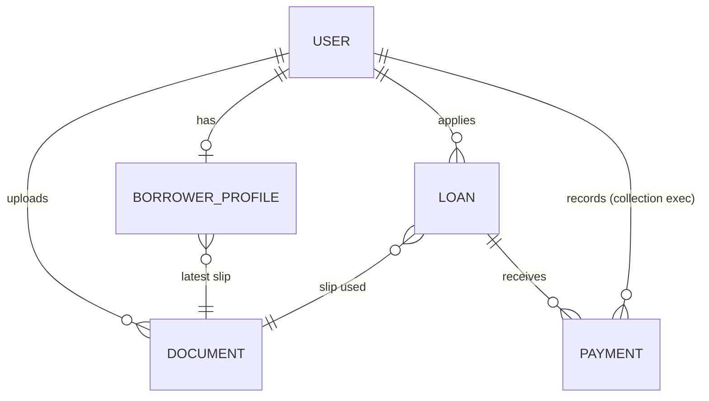

# Loan Management System — Build Plan

Source: `LMS_Assignment (1).pdf`. This plan covers every requirement in the PDF, answers every "Think about" question it asks, and orders the work by the evaluation weights.

## 0. How we get graded (and what that means for us)

| Area | Weight | What we do about it |
|---|---|---|
| End-to-end working flow | 35% | Build the full happy path first (apply → sanction → disburse → pay → auto-close) before any polish |
| Code quality + TypeScript | 20% | Strict TS, no `any`, layered backend (routes → controllers → services → models), zod validation, shared types |
| Correct BRE + loan math | 15% | BRE and SI math live in one shared module with unit tests for edge cases (age exactly 23/50, salary exactly 25,000, rounding) |
| RBAC (frontend + backend) | 15% | `authenticate` + `authorize(...roles)` middleware on every route, plus Next.js `middleware.ts` route guards and role-filtered UI |
| UI/UX + responsiveness | 10% | Tailwind, mobile-first, stepper, loading, empty and error states, toasts |
| README + repo hygiene | 5% | README answers every design question in the PDF, `.env.example`, seed credentials table, clean commits |

> The PDF says: *"A complete basic system always scores higher than a half-built one with extras."* We build features in that order.

## 1. Tech stack (required by the PDF)

- **Frontend:** Next.js 15 (App Router) + React + TypeScript + Tailwind CSS
- **Backend:** Node.js + Express + TypeScript
- **DB:** MongoDB (Atlas free tier, which is a replica set, so transactions work) + Mongoose
- **Auth:** JWT + bcrypt
- **Extras:** zod (validation), multer (uploads), helmet, cors, express-rate-limit, Vitest + Supertest + mongodb-memory-server (tests)

## 2. Repo / folder structure (npm workspaces monorepo)

```
Creditsea/
├── package.json              # workspaces: backend, frontend, shared; root scripts (dev, seed, test)
├── README.md
├── .gitignore
├── shared/                   # code used by BOTH client and server
│   └── src/
│       ├── constants.ts      # ROLES, LOAN_STATUS, limits (50K–5L, 30–365 days, 12%)
│       ├── bre.ts            # runBre(input) -> { passed, failures[] }
│       ├── loanMath.ts       # calculateLoan(principal, tenureDays)
│       ├── schemas.ts        # zod schemas (register, profile, loan apply, payment)
│       └── types.ts          # DTO types shared by API + UI
├── backend/
│   ├── .env.example
│   ├── src/
│   │   ├── app.ts            # express app (no listen; used by tests)
│   │   ├── server.ts         # connect DB + listen
│   │   ├── config/env.ts     # zod-validated env vars (app fails fast if one is missing)
│   │   ├── models/           # User, BorrowerProfile, Document, Loan, Payment
│   │   ├── middleware/       # authenticate, authorize, validate, upload, errorHandler
│   │   ├── modules/
│   │   │   ├── auth/         # routes, controller, service
│   │   │   ├── borrower/
│   │   │   ├── loans/        # includes loanStateMachine.ts
│   │   │   ├── sales/
│   │   │   ├── sanction/
│   │   │   ├── disbursement/
│   │   │   └── collection/
│   │   ├── utils/            # ApiError, asyncHandler, money helpers
│   │   └── scripts/seed.ts
│   ├── uploads/              # gitignored
│   └── tests/
└── frontend/
    ├── .env.example
    ├── middleware.ts         # route guard by role (reads JWT cookie)
    └── src/
        ├── app/
        │   ├── (auth)/login, (auth)/register
        │   ├── apply/        # multi-step borrower flow (personal → documents → loan)
        │   ├── my-loans/     # borrower loan status + timeline
        │   └── dashboard/    # layout with role-filtered sidebar
        │       ├── sales/ sanction/ disbursement/ collection/
        ├── components/       # ui/ (Button, Input, Slider, Table, Badge, Modal), feature components
        ├── lib/              # api client, auth helpers, formatters (₹ en-IN)
        └── hooks/
```

**Why a `shared` package:** the PDF asks *"Should BRE live on the client, server, or both?"* Our answer is both, from one source of truth. The server is authoritative, and the client runs the same function for instant feedback. The same goes for loan math, so the live panel and the stored values can never disagree.

## 3. Data model (MongoDB collections)

All money is stored as **integer paise**, so floating-point bugs can't happen. The API and UI convert to rupees.

### `users`
| field | type | notes |
|---|---|---|
| name | string | |
| email | string | unique, lowercased, indexed |
| passwordHash | string | bcrypt (cost 10), `select: false` |
| role | enum | `ADMIN, SALES, SANCTION, DISBURSEMENT, COLLECTION, BORROWER` |
| isActive | boolean | default true |
| timestamps | | |

Roles are stored as a single enum field on the user. That is simple, indexable, and travels in the JWT.

### `borrowerprofiles` (1:1 with a BORROWER user)
| field | notes |
|---|---|
| user | ref User, unique |
| fullName, pan (uppercase), dob, monthlySalary (paise), employmentMode (`SALARIED / SELF_EMPLOYED / UNEMPLOYED`) | |
| bre | `{ passed: boolean, failures: [{rule, message}], checkedAt }` |
| salarySlip | ref Document (latest upload) |

We persist profiles that fail the BRE too, so the Sales team can see those leads and why they failed.

### `documents` (uploaded salary slips)
`owner` (ref User), `originalName`, `storedName` (random UUID), `mimeType`, `size`, `path`, timestamps.

### `loans`
| field | notes |
|---|---|
| borrower | ref User, indexed |
| applicant | **snapshot** of profile at apply time (fullName, pan, dob, monthlySalary, employmentMode). The loan record stays accurate even if the profile is later edited |
| salarySlip | ref Document |
| principal, interestRate (1200 bps = 12%), tenureDays | |
| simpleInterest, totalRepayment, amountPaid | paise; outstanding = totalRepayment − amountPaid (exposed as a virtual) |
| status | `APPLIED, SANCTIONED, REJECTED, DISBURSED, CLOSED`, indexed |
| rejectionReason | required when REJECTED |
| sanctionedBy/At, disbursedBy/At, closedAt | audit |
| statusHistory | `[{ from, to, by, at, note }]` → drives a timeline in the UI |
| consent | `{ accepted: true, acceptedAt, ipAddress }`. Proof the borrower agreed to the terms (see §4.1) |
| keyFactStatement | snapshot of the figures shown at apply time (principal, rate, tenure, interest, total repayment, due date), so the loan proves exactly what the borrower saw |

### `payments`
`loan` (ref, indexed), `utr` (**unique index**, trimmed and uppercased), `amount` (paise), `paymentDate`, `recordedBy` (ref User), timestamps.

**Relationships:** User 1—1 BorrowerProfile, User 1—N Document, User 1—N Loan, Loan 1—N Payment.



### 3.1 Schema optimization & relationship decisions

**Embed vs reference.** Each choice is deliberate and will be explained in the README:
| Data | Choice | Why |
|---|---|---|
| `statusHistory` in Loan | **Embed** | Bounded (max ~5 entries), always read with the loan, so we never need a join |
| `applicant` snapshot in Loan | **Embed (denormalized copy)** | The loan is a legal record of what was approved. The Sanction queue renders without a `$lookup` |
| Payments | **Reference** (own collection) | Unbounded growth, need their own unique index (UTR), queried independently |
| BorrowerProfile | **Separate collection, 1:1** | Keeps `users` lean for auth lookups on every request. Executives never have a profile |
| Documents | **Separate collection** | File metadata reused by profile and loan, and access-controlled independently |
| `amountPaid` on Loan | **Denormalized counter** | Outstanding balance is O(1) to read. Kept consistent by updating it inside the same transaction as the payment insert |

**Indexes** (each one serves a real query):
| Collection | Index | Serves |
|---|---|---|
| users | `{ email: 1 }` unique | login |
| users | `{ role: 1, createdAt: -1 }` | Sales leads list (borrowers, newest first) |
| borrowerprofiles | `{ user: 1 }` unique | 1:1 lookup |
| borrowerprofiles | `{ pan: 1 }` unique | one PAN = one borrower (stops duplicate accounts with the same PAN) |
| loans | `{ status: 1, createdAt: -1 }` | every ops queue (Sanction = APPLIED, Disbursement = SANCTIONED, Collection = DISBURSED) |
| loans | `{ borrower: 1, createdAt: -1 }` | "my loans" + Sales `$lookup` |
| loans | `{ borrower: 1 }` unique, **partial** on `{ isOpen: true }` | **The DB itself guarantees one open loan per borrower.** That stays true even under a race condition, not just in app code |
| payments | `{ utr: 1 }` unique | duplicate UTR protection at DB level |
| payments | `{ loan: 1, paymentDate: -1 }` | payment ledger per loan |

`isOpen` is a boolean the state machine keeps true for APPLIED, SANCTIONED, and DISBURSED, and sets to false on REJECTED or CLOSED.

**Query practices:**
- `.lean()` + explicit projections on every list endpoint (no hydrating full documents, `passwordHash` never selected)
- Pagination (`page`, `limit` capped at 50) with `Promise.all([find, countDocuments])` run in parallel
- Sales leads = one **aggregation pipeline**: `$match role=BORROWER` → `$lookup` loans (index-backed, `$limit: 1`) → `$match` no loan → `$lookup` profile → `$addFields stage` → `$facet` (data + total)
- Admin stats = one `$facet` aggregation (counts per status + sums), not N queries
- Multi-document writes (payment + loan update + auto-close) inside a **transaction**. State transitions use **conditional atomic updates** (`{ _id, status: from }`)
- Mongoose schema validation (enums, min/max, required) as a second safety net behind zod
- `compression`, `helmet`, request logging with `pino-http` + request id, graceful shutdown (close DB on SIGTERM)

## 4. Business rules

### BRE (in `shared/bre.ts`, runs on the server on `PUT /borrower/profile`)
| Rule | Pass condition |
|---|---|
| Age | 23 ≤ age ≤ 50 (age computed correctly: subtract 1 if this year's birthday hasn't happened yet) |
| Salary | monthlySalary ≥ ₹25,000 |
| PAN | `^[A-Z]{3}[ABCFGHLJPT][A-Z][0-9]{4}[A-Z]$`, checked after uppercasing and trimming |
| Employment | not `UNEMPLOYED` |

- **PAN regex rationale:** 5 letters, 4 digits, 1 letter. The 4th character is the holder type (P = individual, C = company, H = HUF, …), so we validate that too, instead of the naive `[A-Z]{5}[0-9]{4}[A-Z]`.
- We return **all** failed rules at once, not just the first, so the user sees everything to fix. The server responds `422` with `failures[]`.
- **Client + server:** the client check is UX only. Anyone can call the API directly, so the server is the gatekeeper, and loan creation re-checks `profile.bre.passed`.

### Loan math (`shared/loanMath.ts`)
```
SI = (P × R × T) / (365 × 100)     R = 12, T = tenure in days
Total = P + SI                     rounded to the nearest paisa
```
Example: P = ₹1,00,000, T = 180 → SI = ₹5,917.81, Total = ₹1,05,917.81.
**The server recalculates** on apply and ignores any totals the client sends. The client sends only `principal` and `tenureDays`.

Validation: principal 50,000–5,00,000, tenure 30–365 (integers). Slider steps are ₹1,000 and 1 day.

### Loan state machine (`loanStateMachine.ts`)
```
            ┌──────────► REJECTED (reason required)
APPLIED ────┤
            └──────────► SANCTIONED ──► DISBURSED ──► CLOSED (automatic)
```
| Transition | Who |
|---|---|
| — → APPLIED | BORROWER (apply) |
| APPLIED → SANCTIONED | SANCTION, ADMIN |
| APPLIED → REJECTED | SANCTION, ADMIN |
| SANCTIONED → DISBURSED | DISBURSEMENT, ADMIN |
| DISBURSED → CLOSED | System, when amountPaid == totalRepayment |

- One table defines the allowed `{from, to, roles}`. Any other transition gets **409 Conflict**.
- Updates are **atomic and conditional**: `findOneAndUpdate({ _id, status: from }, …)`. If two executives click Approve at once, only one wins and the other gets 409.
- A borrower can have only **one open loan** (APPLIED / SANCTIONED / DISBURSED) at a time. A new application is allowed after CLOSED or REJECTED.

### Payments (Collection)
Validations:
- Loan must be `DISBURSED`, otherwise 409
- `amount > 0` and `amount ≤ outstanding`. **Overpayment is not allowed** (400)
- `paymentDate` must not be in the future and must not be before `disbursedAt`
- UTR: required, 6–30 alphanumeric characters, normalized to uppercase, **unique** (DB unique index, and duplicate key error 11000 → **409**)

Recording a payment happens in a **MongoDB transaction**: insert the payment, `$inc` amountPaid on the loan, and if outstanding is 0, set `CLOSED` + `closedAt` + a history entry. Outstanding balance = `totalRepayment − amountPaid`. It is kept on the loan for fast reads, and the payments ledger can always re-derive it.

### 4.1 Compliance features (lending best practice, built after the E2E flow works)
| Feature | What we build | Why it matters |
|---|---|---|
| **Key Fact Statement (KFS)** | Step 3 shows a "Key Facts" card before Apply: loan amount, 12% p.a. rate, tenure, interest, total repayment, due date. The same figures are stored on the loan as `keyFactStatement` | Regulated lenders must show the full cost of a loan before the borrower agrees to it |
| **Explicit consent** | A required checkbox: "I have read the Key Facts and agree to the loan terms". `POST /api/loans` rejects the request with **400** if `consentAccepted !== true`, and stores `consent.acceptedAt` + `ipAddress` | The server enforces it, so a direct API call can't skip it |
| **PAN masking** | Loan/lead DTOs return `ABCPE****F` for every role except SANCTION and ADMIN, the only roles that need the full PAN to verify the borrower | Data minimization: each role sees only what its job needs |
| **Audit trail** | Already in place: `statusHistory` records who changed what and when, payments record `recordedBy` | Every state change can be traced to a person |
| **Separation of duties** | Already in place: the person who approves a loan (SANCTION) can't disburse it (DISBURSEMENT), and neither can record payments (COLLECTION). Only ADMIN spans all modules | Lowers fraud risk |
| **Document access control** | Already in place: salary slips are served only through an authenticated endpoint (owner, SANCTION, ADMIN), never as public static files, with random filenames on disk | Sensitive financial documents stay private |

*Future work (README only, not built):* KYC/Aadhaar e-verification, credit bureau check (CIBIL), cooling-off/look-up period after disbursement, grievance redressal contact, field-level encryption of PAN at rest.

## 5. Auth & RBAC

- **JWT** `{ sub: userId, role }`, 1-day expiry, stored in an **httpOnly, SameSite=Lax cookie**. That protects the token from XSS, and Next.js `middleware.ts` can read it.
- **Same-origin trick:** Next.js `rewrites` proxy `/api/*` to the Express server, so the cookie is first-party and CORS headaches go away (in dev and on deploy).
- **`authenticate`** verifies the JWT and loads the user from the DB (so a deactivated user or changed role takes effect immediately). It fails with **401 Unauthorized**.
- **`authorize(...roles)`**: ADMIN always passes. Otherwise the role must be in the list, or the request gets **403 Forbidden**.
  - 401 = "we don't know who you are", 403 = "we know, and you're not allowed". This distinction is a direct answer to the PDF's question.
- **Frontend:** `middleware.ts` verifies the cookie with `jose` and redirects:
  - not logged in → `/login`
  - BORROWER → only `/apply`, `/my-loans`
  - executive → only `/dashboard/<their module>`; ADMIN → every `/dashboard/*`
  - Sidebar shows only the allowed modules. Executives visiting `/apply` are redirected to their module.
- Public registration always creates a **BORROWER**. Executive accounts come only from the seed (a client can't send `role: ADMIN` at signup).
- `express-rate-limit` on `/auth/login` and `/auth/register`, plus `helmet`.

## 6. REST API

Response envelope: `{ success: true, data }` / `{ success: false, error: { code, message, details? } }`.

| Method | Route | Role | Notes / codes |
|---|---|---|---|
| POST | /api/auth/register | public | 201; 409 email exists |
| POST | /api/auth/login | public | 200 sets cookie; 401 bad creds |
| POST | /api/auth/logout | any | clears cookie |
| GET | /api/auth/me | any | current user |
| GET | /api/borrower/profile | BORROWER | profile + BRE result + slip + current step |
| PUT | /api/borrower/profile | BORROWER | runs BRE; 200 pass / 422 `{failures}` |
| POST | /api/borrower/salary-slip | BORROWER | multipart; requires BRE passed; 415 bad type, 413 > 5 MB |
| POST | /api/loans | BORROWER | `{principal, tenureDays, consentAccepted: true}`; requires BRE + slip; 201; 400 no consent; 409 open loan exists |
| GET | /api/loans/me | BORROWER | own loans with history |
| GET | /api/documents/:id | owner, SANCTION, ADMIN | streams file (never public static) |
| GET | /api/sales/leads | SALES | borrowers with no loan: stage (Registered / Profile done / BRE failed / Slip uploaded), search, pagination |
| GET | /api/sanction/loans | SANCTION | status=APPLIED by default |
| PATCH | /api/sanction/loans/:id/approve | SANCTION | → SANCTIONED |
| PATCH | /api/sanction/loans/:id/reject | SANCTION | `{reason}` (min 10 chars) → REJECTED |
| GET | /api/disbursement/loans | DISBURSEMENT | status=SANCTIONED |
| PATCH | /api/disbursement/loans/:id/disburse | DISBURSEMENT | → DISBURSED |
| GET | /api/collection/loans | COLLECTION | status=DISBURSED (+ CLOSED filter) with outstanding |
| GET | /api/collection/loans/:id | COLLECTION | loan + payments ledger |
| POST | /api/collection/loans/:id/payments | COLLECTION | `{utr, amount, paymentDate}`; 201; 409 dup UTR; 400 overpay; may auto-close |
| GET | /api/admin/stats | ADMIN | counts per status, total disbursed/collected (nice-to-have) |

Every ops route also accepts ADMIN via `authorize`. Errors from zod → 400 with field details. Unknown route → 404. A central error handler maps Mongoose/multer/JWT errors to the codes above.

## 7. Frontend UX

### 7.0 Design principles: attractive AND usable by someone who can barely read
- **Icon + word everywhere.** Every field, step, button, and status has an icon (lucide-react) next to a 1–3 word label. Status = color + icon + word, never color alone.
- **Very few fields per screen, one clear action.** One big primary button per screen ("Next →", "Apply for Loan"), placed in the same spot every time.
- **Big touch targets** (≥ 48px), large readable text (16px+ body, 18px inputs), high contrast (WCAG AA).
- **Plain-language errors** next to the field, with an icon: "You must be 23 to 50 years old", not "Age validation failed".
- **Inputs that prevent mistakes:**
  - PAN auto-uppercases and shows the `ABCDE1234F` pattern as a hint
  - salary shows `₹` with Indian commas as you type
  - DOB uses a simple date picker
  - employment mode is three big tappable cards with icons, not a dropdown
- **Sliders with +/− buttons and quick-pick chips** (₹50K, ₹1L, ₹2L, ₹5L / 30, 90, 180, 365 days), for people who struggle with dragging.
- **Big friendly numbers** in the live panel: "You get ₹1,00,000 · You pay back ₹1,05,917".
- **Progress stepper** with icons and "Step 2 of 3". Success screens with a check animation.
- **Visual identity:** one brand color (deep indigo + emerald accent), Inter via `next/font`, soft cards with rounded-2xl, subtle shadows, gradient hero on auth pages, skeleton loaders, toasts (sonner), smooth Tailwind transitions.
- *Stretch (only if time is left):* English / हिंदी toggle for the borrower portal.

**Borrower portal**
- Register / Login pages with inline validation.
- `/apply` stepper: **Personal Details → Salary Slip → Loan Config**. The current step is derived from server state, so a refresh or re-login resumes where the user left off. Earlier steps can be reviewed.
- Step 1: the form runs the shared BRE live, and the server response is shown as a clear red panel listing every failed rule.
- Step 2: drag-and-drop or click to upload, client-side type/size check, file preview name, replace option.
- Step 3: two sliders + numeric display, plus a **live calculation panel** (Principal, Rate 12% p.a., Tenure, Interest, Total Repayment) formatted as `₹1,05,917.81`. Below it, a **Key Facts card** and a big **consent checkbox** ("I agree to these loan terms"). The Apply button stays disabled until the box is ticked, then a confirm modal leads to Apply.
- `/my-loans`: status badge + timeline (Applied → Sanctioned → Disbursed → Closed, or Rejected with the reason), amount paid and outstanding.

**Operations dashboard**
- Responsive sidebar (drawer on mobile), header with user and role chip, logout.
- Each module: data table (cards on mobile), search, status filter, empty state, loading skeleton.
- Sanction: view applicant details + **open salary slip**, Approve / Reject (modal requiring a reason).
- Disbursement: Mark Disbursed with a confirm modal.
- Collection: loan detail with a progress bar (paid/total), payments ledger, Record Payment form (UTR, amount prefilled to outstanding, date). After the last payment, a "Loan closed" toast appears.
- Admin: all 4 modules + optional stats cards.

## 8. Seed script (`npm run seed`)

Idempotent (upserts). Creates:

| Role | Email | Password |
|---|---|---|
| Admin | admin@lms.dev | Password@123 |
| Sales | sales@lms.dev | Password@123 |
| Sanction | sanction@lms.dev | Password@123 |
| Disbursement | disbursement@lms.dev | Password@123 |
| Collection | collection@lms.dev | Password@123 |
| Borrower | borrower@lms.dev | Password@123 |

It also creates **sample data** so every dashboard has something to show immediately: a couple of leads at different stages, and one loan each in APPLIED, SANCTIONED, and DISBURSED with a partial payment.

## 9. Testing (code-quality signal, cheap to do)

- **Unit (shared):** BRE boundaries (age 22/23/50/51 including birthday-not-yet-passed, salary 24,999/25,000, valid/invalid PANs, unemployed), loan math (min/max values, rounding).
- **Integration (backend, Supertest + in-memory Mongo):** 401 without token, 403 for wrong role, admin allowed, invalid transition 409, duplicate UTR 409, overpayment 400, final payment → CLOSED.

## 10. 48-hour schedule (backend first, because it's the priority)

| Hours | Block | Done when |
|---|---|---|
| 0–2 | **Scaffold:** monorepo, strict TS, ESLint/Prettier, Express skeleton, Next.js + Tailwind, Atlas connection, git init | both apps boot, DB connects |
| 2–10 | **Complete backend:** models + indexes, auth, RBAC middleware, BRE, upload, loans, state machine, sanction/disbursement/collection with transactions, sales aggregation, stats, seed | the full flow works through HTTP calls (`.http` file committed) |
| 10–12 | **Backend tests:** BRE + math unit tests, RBAC/transition/UTR/auto-close integration tests | `npm test` green |
| 12–19 | **Sleep** | |
| 19–22 | **Design system + auth UI:** layout, components (Button, Input, Card, Badge, Stepper, Slider, Table, Modal), login/register, route guard middleware | login redirects by role |
| 22–28 | **Borrower portal:** 3-step apply flow, live panel, my-loans timeline | borrower completes the journey in the UI |
| 28–34 | **Ops dashboard:** sidebar, Sales, Sanction (slip viewer), Disbursement, Collection (ledger + record payment), admin | **full E2E in the UI** ✅ |
| 34–37 | **Compliance features (~1–2h):** KFS card + consent checkbox, server-side consent check, PAN masking. **QA pass:** run the video script end to end, fix bugs, mobile responsive check, empty/error states | no broken step |
| 37–42 | **Sleep** | |
| 42–45 | **README** with ER diagram, state diagram, design decisions, API table, credentials | |
| 45–47 | **Record video**, final push | |
| 47–48 | Buffer + submit | |

**Cut list if we fall behind** (in this order): Hindi toggle → deployment → admin stats → PAN masking → integration tests (keep the unit tests). KFS + consent stay because they're small and visible in the video. The core E2E flow and RBAC are never cut.

## 11. README outline (5% but also the first impression)

1. Overview + screenshots
2. Tech stack & architecture diagram (monorepo, request flow)
3. Setup: prerequisites, `npm install`, env vars, `npm run seed`, `npm run dev`
4. **Login credentials table**
5. **Design decisions** — explicit answers to every "Think about" in the PDF:
   PAN regex, BRE client vs server, status transitions + who triggers them, outstanding-balance tracking, payment validations, role storage, middleware design, 401 vs 403
6. Data model (collections + relationships), API reference table
7. Loan math with a worked example
8. **Compliance & Security:** KFS + consent, PAN masking, audit trail, separation of duties, document access control, security basics (bcrypt, httpOnly cookie, helmet, rate limiting, file signature checks)
9. Running tests
10. Known limitations / future work (e.g. S3 for files, refresh tokens, audit log UI, KYC/credit bureau/cooling-off from §4.1)

Repo hygiene: meaningful commits per feature, `.gitignore` (node_modules, .env, uploads, .next, dist), no secrets committed, `.env.example` for backend and frontend.

## 12. Submission checklist

- [ ] GitHub repo (add the evaluator if private) with README + `.env.example`
- [ ] Video, 3–5 min, YouTube unlisted / Drive:
  1. (0:00) Intro + architecture in 20 seconds
  2. Borrower signup → **BRE fail** (e.g. age 21 or salary 20K, showing multiple errors) → fix → **BRE pass**
  3. Upload slip (show a >5 MB or .docx rejection quickly) → sliders with the live panel → **Key Facts card + consent checkbox** (~10 s) → Apply
  4. Login as Sanction → view slip → Approve (optionally show a Reject with reason on another loan)
  5. Disbursement → Mark Disbursed
  6. Collection → partial payment → **duplicate UTR rejected** → final payment → **auto CLOSED**
  7. RBAC demo: Sales user opens `/dashboard/sanction` and gets redirected; API call gets 403
  8. Borrower sees the timeline ending in CLOSED
- [ ] Login credentials for all roles (in the README + submission email)
- [ ] Optional but valuable: live deployment (Vercel frontend, Render backend, Atlas DB). Note: Render's disk is ephemeral, so uploads would need Cloudinary/S3 there. Local disk storage is fine for the required submission.
